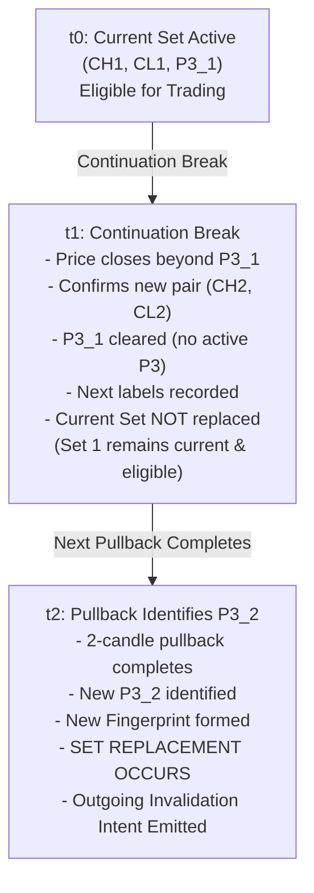

# Trend Joining Level (TJL) — Acceptance Specification

Last Updated: 2026-11-05

> [!IMPORTANT]
> **Specification Authority & Provenance**:
> - **Primary Marking Source**: `docs/strategy/TJL.pdf` (Version 1 — Final marking rules, 14 October 2026, 4:58 PM IST).
> - **Transcription Aid**: [`docs/strategy/extracted/tjl.md`](../strategy/extracted/tjl.md).
> - **Multi-Timeframe & Entry Confirmation Source**: `docs/strategy/MTF-Analysis.pdf` (Version 1 — Consolidated rule record, 26 October 2026, 12:58 AM IST), transcribing `Entry_and_Confirmation_New_Rules.pdf` with approved user decisions.
> - **Transcription Aid**: [`docs/strategy/extracted/mtf-analysis.md`](../strategy/extracted/mtf-analysis.md).
> - **Approved Clarifications**: [`docs/requirements/approved-clarifications.md`](approved-clarifications.md) (OPEN-02, OPEN-03, OPEN-04, OPEN-05, OPEN-06, OPEN-07, OPEN-08, OPEN-09, OPEN-10, OPEN-11, OPEN-12).
> - **Detailed Lifecycle Provenance**: Project artifact `aladin_topg_dashboard_e6a30e5e.plan.md` (*"Aladin TopG Dashboard — Revised Contract"*, Section 6), recording OPEN-02 approval dated **4 November 2026**.
> - **Strict Safety & Scope Boundary**: Pure read-only market-structure and set-lifecycle specification. Strictly **zero trade execution, zero order placement, zero automated entry signals, and zero position gating**.

---

## 1. Scope, Purpose, and Framework

Trend Joining Level (TJL) provides structural price levels and zones for existing confirmed market-structure points established by the approved Market Structure Marking (MSM) engine.
- **TJL is not a separate structure-marking algorithm**: It does not execute an independent swing search, confirmation cycle, or pullback test. Whenever MSM establishes or updates a confirmed point, its TJL role and zone follow deterministically.
- **Independent Source Timeframes**: TJL operates on D1, H4, and H1 independently. No cross-timeframe agreement is required to establish levels or sets.
- **Role in the Trading Hierarchy**:
  - TJL levels are the **only source of marked trade-finding levels** in the strategy.
  - Market structure supplies the structural points.
  - Main CHOCH and ISS serve higher-timeframe analysis; on lower timeframes, normal CHOCH and ISS serve as entry confirmation after a TJL level activates.
- **Overridden Obsolete Rules**:
  - *Volatility selection*: Excluded per user decision (14 October 2026). No normal vs. volatile market classification.
  - *TJL2-only trading restriction*: Superseded by `MTF-Analysis.pdf` Section 3 and Q&A 20–21 (26 October 2026). Both TJL1 and TJL2 are eligible for activation in the structure's trend direction.

---

## 2. Section A: Confirmed-Point Labeling

### 2.1 Directional Point-to-Label Mapping
TJL maps the two latest confirmed structural points of the primary market structure to TJL roles:

| Main Structure Trend | TJL1 Role | TJL2 / A+ Role | Trade Direction for Both |
|---|---|---|---|
| **Bullish** | Confirmed High (`CH`) | Latest Confirmed Low (`CL` / LSM) | **Buy** |
| **Bearish** | Confirmed Low (`CL`) | Latest Confirmed High (`CH` / LRM) | **Sell** |

- **LSM (Last Support in Market)**: Latest confirmed low in bullish structure.
- **LRM (Last Resistance in Market)**: Latest confirmed high in bearish structure.
- **Tentative Points Excluded**: Only confirmed swing points receive TJL roles. The active tentative swing point (`tentative_high` / `tentative_low`, Point 3) **never** supplies a TJL zone.

### 2.2 Labeling vs. Trading Eligibility
- Confirmed points receive TJL labels as soon as they are confirmed by the MSM engine.
- **Labels alone do NOT constitute an eligible trading set**: A confirmed point can be labeled, visible, and tracked without yet belonging to an active current trading set (e.g. before the first Point 3 is identified, or during a continuation break before the next Point 3 forms).

---

## 3. Section B: Original-Candle Zone Geometry

### 3.1 Source Candle & Body-to-Wick Construction
Every TJL zone is constructed strictly from the **original candle** of the underlying confirmed swing point:
1. **Body Edges**:
   $$\text{Upper Body Edge} = \max(\text{open}, \text{close})$$
   $$\text{Lower Body Edge} = \min(\text{open}, \text{close})$$
2. **Zone Side by Role**:
   - **High-Side Zones** (`[upper body edge, top wick]`):
     - Bullish TJL1 (Confirmed High)
     - Bearish TJL2 / A+ (Confirmed High / LRM)
     $$\text{Zone Boundaries} = [\max(\text{open}, \text{close}),\, \text{high}]$$
   - **Low-Side Zones** (`[bottom wick, lower body edge]`):
     - Bullish TJL2 / A+ (Confirmed Low / LSM)
     - Bearish TJL1 (Confirmed Low)
     $$\text{Zone Boundaries} = [\text{low},\, \min(\text{open}, \text{close})]$$

### 3.2 Zero-Width Lines (Missing Relevant Wick)
If the original candle has no wick on the relevant side (i.e. `high == max(open, close)` for a high-side zone, or `low == min(open, close)` for a low-side zone):
- The zone **remains a labeled single price line**.
- It is **never artificially widened**, buffered, or substituted with another candle.
- In calculations, its upper price equals its lower price ($y_0 = y_1$).

---

## 4. Section C: Current-Set Lifecycle (OPEN-02)

### 4.1 Prerequisites for the First Eligible Set
The current eligible TJL set requires three structural components:
1. Confirmed High (`CH`)
2. Confirmed Low (`CL`)
3. Active Tentative Point 3 (`P3`): identified by a valid 2-candle pullback in the current structure.

### 4.2 First Set Creation Timing
- **Creation Bar**: The first eligible set is created at the **close of the candle that identifies the first active P3** (the close of the second pullback candle $p_2$).
- **Eligibility Availability**: Member trading eligibility becomes available at that identification close time, **NOT** at the earlier confirmed-point completion times.
- **Non-Replacement**: First set creation is an initialization event, **not a replacement**. It emits zero outgoing cancellation intents.

### 4.3 Set Fingerprint
Every candidate TJL set is uniquely identified by its structural fingerprint:
$$\text{Set Fingerprint} = (\text{source\_engine\_id},\, \text{direction},\, \text{ch\_point\_id},\, \text{cl\_point\_id},\, \text{p3\_point\_id})$$

### 4.4 Lifecycle Progression: $t_0 \to t_1 \to t_2$
The lifecycle of current trading sets across market structure continuation follows the formal OPEN-02 specification:

1. **State $t_0$ (Active Current Set)**:
   - Formed by `CH1`, `CL1`, and active `P3_1`.
   - Both TJL1 and TJL2 members are currently eligible for trading.
2. **State $t_1$ (Continuation Break — Labels Without Replacement)**:
   - A continuation candle closes strictly beyond the tentative level `P3_1`.
   - MSM confirms a new swing pair: one point is confirmed and the opposite point is finalized (`CH2`, `CL2`).
   - The old tentative point `P3_1` is broken and cleared; **no active tentative point exists at $t_1$**.
   - Newly confirmed points receive their TJL labels (`CH2` labeled next TJL1, `CL2` labeled next TJL2).
   - **Crucial Rule**: The current trading set is **NOT replaced at $t_1$**. Set 1 remains the active, current, eligible set because a new 3-point set has not yet completed.
3. **State $t_2$ (Next Pullback — Set Replacement & Cancellation Intent)**:
   - Subsequent price action forms a valid 2-candle pullback, identifying a new active tentative point `P3_2`.
   - A new distinct fingerprint is formed: `(engine_id, direction, CH2, CL2, P3_2)`.
   - **Replacement Event**: The new set replaces Set 1 as the current eligible set.
   - **Outgoing Invalidation Intent**: Set replacement emits an outgoing-set cancellation intent that invalidates pending activations for Set 1.
   - **Non-Inheritance**: Any pending activation on the replaced set is cancelled. The replacement set requires its own fresh tap.
   - **Persistent Member Coverage**: The cancellation intent applies to the outgoing set as a whole even if an underlying swing point carries forward into the new set.

### 4.5 Idempotence
Re-evaluating or re-observing the market structure while the fingerprint remains identical produces zero state mutations and emits zero cancellation intents.

---

## 5. Section D: Stable Level Identity & Usage Boundaries

### 5.1 Stable Level Identity Formula
To prevent level duplication, re-observation artifacts, and artificial usage resets, every TJL level possesses an immutable engineering identity:
$$\text{Level ID} = (\text{symbol\_feed\_id},\, \text{source\_timeframe},\, \text{source\_open\_time},\, \text{HIGH} \mid \text{LOW})$$

- **Excluded Attributes**: Role name (`TJL1` vs `TJL2`), calendar week, activation ID, candidate ID, and set fingerprint are strictly **excluded** from the level identity.
- **Relabeling Invariance**: If an existing swing point is relabeled or carries forward from an old set to a new set, its `Level ID` remains **100% identical**.
- **Isolation**: Level identities are strictly isolated by data feed and timeframe configuration.

### 5.2 One Trade Per Level (Usage Invariance)
Per `MTF-Analysis.pdf` Section 10:
- Each physical TJL level can supply at most **one trade**.
- Usage is caused strictly by a **selected winning trade entry**, never by a touch, activation, cancellation, or set replacement.
- **Usage Never Resets**: Once a level is marked used, its used status is permanently retained across relabeling, set replacement, reactivations, and weekly carry-over.

---

## 6. Section E: Source CHOCH & Weekly Retention

### 6.1 Source Main CHOCH Invalidation
When Main CHOCH confirms on the source timeframe (two consecutive closes beyond last support or resistance):
1. **Immediate Invalidation**: All current TJL trading eligibility in the old direction is immediately invalidated.
2. **Cancellation Intent**: Emits an immediate cancellation intent for any pending activations in the old direction.
3. **Historical Preservation**: Historical TJL labels, zones, and stable level identities remain preserved in historical records; history retention does not imply current trading eligibility.
4. **Post-CHOCH Transition Gap**:
   - Marking restarts in the new direction under approved CHOCH restart rules.
   - The new direction must establish completed confirmed pairs AND an active Point 3 before a new eligible TJL set forms.
   - During this transition gap, **no TJL set is eligible for trading** in either direction.

### 6.2 Weekly Monday Retention
Per `MTF-Analysis.pdf` Section 4 and approved clarification OPEN-10:
- TJL operates on a Monday-to-Monday review cycle.
- If a new 3-point set forms, it replaces the marked set.
- If Monday 00:00 arrives without a new 3-point set forming, the **existing set and levels are retained**.
- **Monday alone never deletes a level, replaces a set, cancels an activation, or resets usage status**. A retained used level remains used.
- **Persisted Source Calendar**: The Monday boundary is evaluated strictly using the native MT5 broker calendar, never inferred from the local computer timezone.

---

## 7. Section F: Timing, Intervals & Wick Precedence

### 7.1 Half-Open Candle Intervals
Per approved clarification OPEN-04:
- All candle intervals are strictly half-open:
  $$\text{Candle Interval} = [\text{open\_time},\, \text{close\_time})$$
- A structural event or level confirmed at the candle close becomes available at $t_{\text{close}}$.

### 7.2 No Retroactive Wick Taps
- A TJL level that becomes available at candle close $t_{\text{close}}$ **cannot reach backward in time** to claim that candle's earlier intra-bar wick as a tap.
- Any tap or activation must occur on or after the candle where eligibility becomes available.

### 7.3 Unknown Event Availability
- If the exact intra-bar timestamp or sequence of an event cannot be determined from available data, it must be represented explicitly as unknown availability (`UNKNOWN_ORDER`); speculative trade signals or ordering assumptions are strictly forbidden.

---

## 8. Section G: Future Activation & Usage Integration Boundaries

This specification defines the structural geometry, lifecycle states, and invalidation intents required for downstream modules:
- **Intents Only**: This milestone specifies invalidation and set-transition intents; it does **not** implement activation listeners, tap watchers, or trade execution.
- **Dual Activation Eligibility**: Downstream entry modules must permit activation of both TJL1 and TJL2 in the trend direction.
- **Independent Usage Tracking**: A downstream usage ledger must track `Level ID` usage independently of set replacements.

---

## 9. Acceptance Criteria & Verification Summary

| # | Requirement | Acceptance Verification Standard |
|---|---|---|
| **AC-01** | Directional Mapping | Bullish maps CH to TJL1 (high-side) and CL to TJL2 (low-side); Bearish maps CL to TJL1 (low-side) and CH to TJL2 (high-side). |
| **AC-02** | Zone Geometry | High-side `[upper body, high]`, low-side `[low, lower body]`. Marubozu / missing wick produces exact single price line ($y_0 == y_1$). |
| **AC-03** | Labels Before Set | Confirmed points receive labels at confirmation; current set remains `None` until first Point 3 is identified. |
| **AC-04** | First Set Creation | At first P3 identification close, current set forms with availability = $t_{\text{close}}$. No outgoing cancellation intent emitted. |
| **AC-05** | $t_1$ Continuation | Continuation break confirms new pair and assigns next labels, but current set is NOT replaced; previous set remains current and eligible. |
| **AC-06** | $t_2$ Replacement | Next pullback identifies P3; new fingerprint replaces current set and emits outgoing cancellation intent. |
| **AC-07** | Stable Level Identity | Identity `(feed, tf, open_time, HIGH/LOW)` is invariant to role changes, set replacements, or weekly transitions. |
| **AC-08** | Persistent Level Invalidation | Outgoing cancellation intent applies to outgoing set even if an underlying level is carried forward into the new set. |
| **AC-09** | Idempotence | Same fingerprint re-observation produces zero replacement or cancellation intents. |
| **AC-10** | Source CHOCH Invalidation | Main CHOCH immediately cancels old-direction trading eligibility; post-CHOCH gap has zero eligible sets until new 3-point structure forms. |
| **AC-11** | Monday Retention | Monday 00:00 alone preserves existing set, levels, and used statuses without reset. |
| **AC-12** | Wick Precedence | Half-open intervals `[open_time, close_time)`; no retroactive intra-bar wick taps before availability close. |
